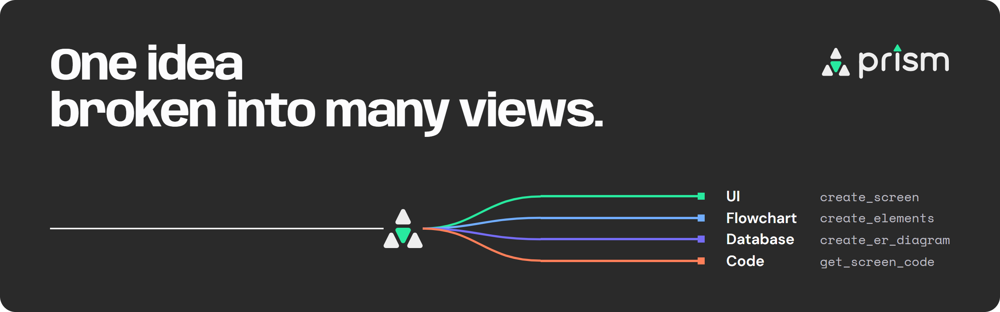
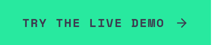
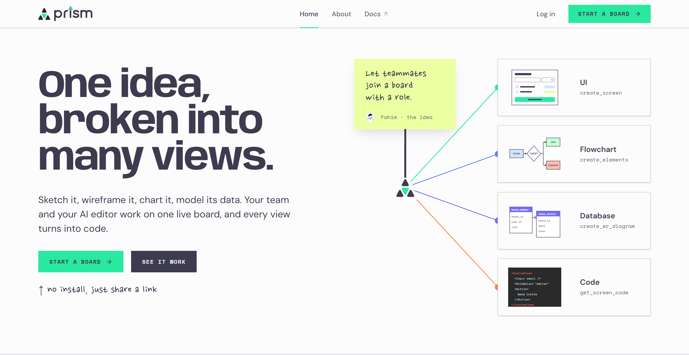
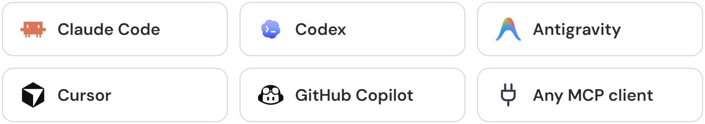
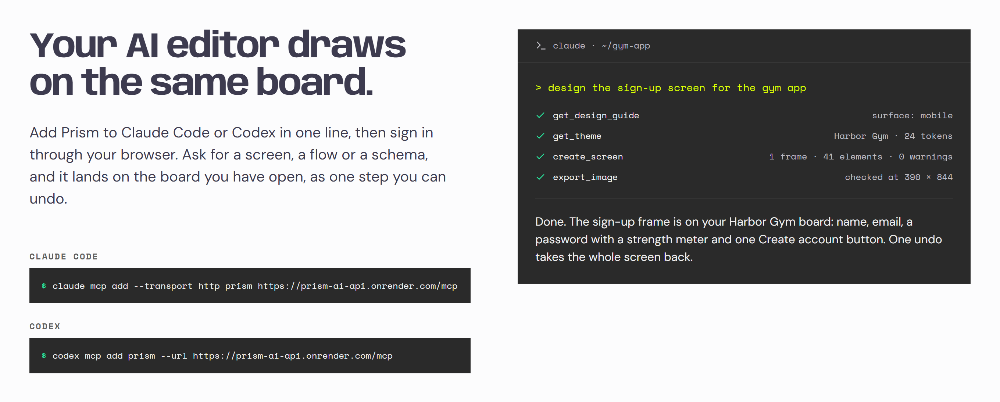
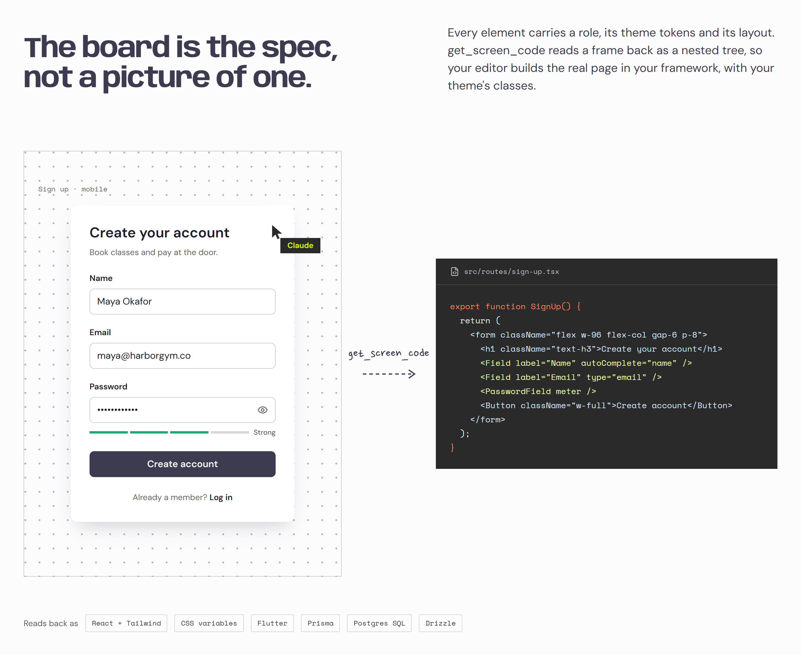
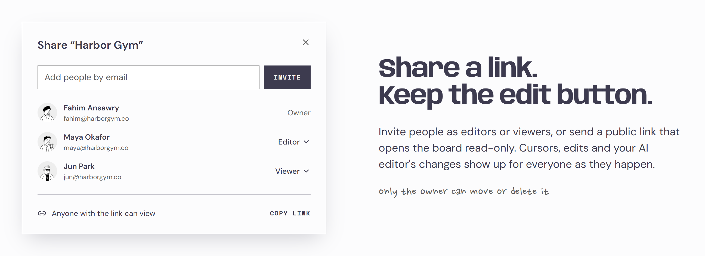
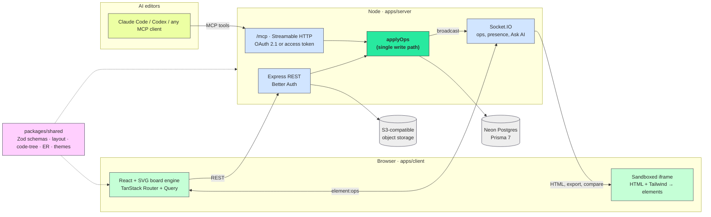
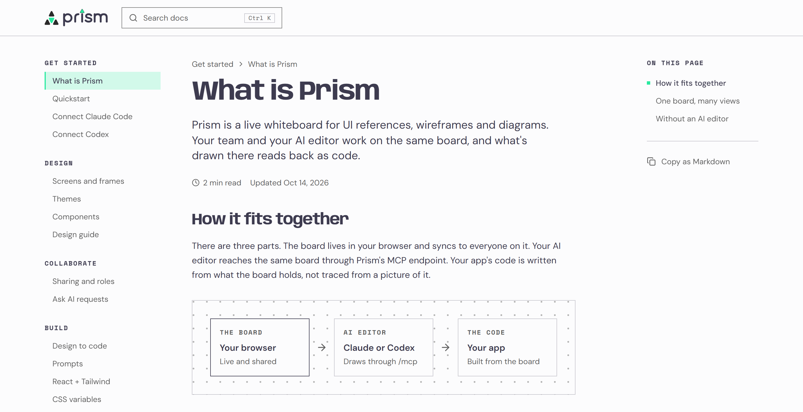

<h1 align="center">
  <a href="https://prism-ai-app.onrender.com"></a>
</h1>

<p align="center">
  <b>A real-time whiteboard and wireframing tool where AI coding agents work on the board with you.</b><br>
  Claude Code, Codex or any other MCP client draws screens, ER diagrams and mind maps on the board you're watching, then reads the board back as code.
</p>

<p align="center">
  <a href="https://prism-ai-app.onrender.com"></a>
  &nbsp;
  <a href="https://prism-ai-app.onrender.com/docs"></a>
</p>

<p align="center">
  
  
  
  
  
  
</p>

<p align="center">
  <a href="#quick-start">Quick start</a> ·
  <a href="#what-it-does">What it does</a> ·
  <a href="#how-it-works">How it works</a> ·
  <a href="#mcp-tools">MCP tools</a> ·
  <a href="#run-it-yourself">Run it yourself</a>
</p>

<br>

<p align="center">
  <a href="https://prism-ai-app.onrender.com"></a>
</p>

## Quick start

Add Prism to your editor in one line, then sign in through the browser.

```sh
# Claude Code: then run /mcp and choose Authenticate
claude mcp add --transport http prism https://prism-ai-api.onrender.com/mcp

# Codex: opens your browser to sign in
codex mcp add prism --url https://prism-ai-api.onrender.com/mcp
```

<p align="center">
  
</p>

Antigravity, Cursor and GitHub Copilot take a JSON config instead. The dashboard's **Connect AI tools** dialog has the snippet for each one. A client that can't sign in through the browser can send a `prism_…` personal access token, made in the same dialog, as `Authorization: Bearer`.

Then ask for a screen, a flow or a schema. It lands on the board you have open, as one step you can undo. On your own server, use `https://<your-server>/mcp`, or `http://localhost:4000/mcp` in development.

The [live demo](https://prism-ai-app.onrender.com) fills in a public demo account on its login form.

## What it does

**The whiteboard.** The drawing engine is written from scratch in React and plain SVG, with no canvas or drawing libraries. It has frames, shapes, connectors with elbow routing, freehand, sticky notes, lists, text, icons, emoji, images, SVG, charts, mind maps and database tables. It also has snapping and alignment guides, align and distribute, grouping, undo and redo, an optional hand-drawn sketch mode, and PNG and PDF export.

### AI editors on the board



- **26 MCP tools and 3 prompts** (listed [below](#mcp-tools)). Whatever an agent draws arrives live, with its cursor labelled with the editor's name.
- **Ask AI.** Select something on the board and click **Ask AI**. A waiting agent picks up the request, makes the edit and marks it done.
- **A design bar for agents.** `get_design_guide` sets the rules, and every `create_screen` call is linted for overflow, text wrapping, contrast, tiny text and too many sizes or accent colors. The agent gets the warnings back.

### Design to code, and back



- **Screens in, code out.** `create_screen` takes a layout tree, or HTML + Tailwind that the browser renders in a sandbox and turns into editable elements. `get_screen_code` returns each frame as a nested tree with inferred row, column, grid and overlay layout, theme tokens and component instances, ready for an agent to code.
- **Project themes and components.** Each project can have a shadcn/ui-style theme (light and dark colors, radius, fonts) and reusable components with props, variants and slots. A saved theme is strict, so agents use tokens instead of raw values. `get_theme` exports it as CSS, CSS variables, JSON or Dart.
- **Schemas both ways.** `create_er_diagram` lays out tables and foreign keys. `get_schema_code` reads the diagram back as Prisma, Postgres SQL or Drizzle.

### Live collaboration



Edits sync over Socket.IO with versioned ops. You see live cursors and presence, and a staged reveal while an AI editor draws. Boards can be shared as owner, editor or viewer through email invites, invite links or read-only public links.

## How it works



- **One write path.** Every element change, whether from a person, a REST call or an MCP tool, goes through `applyOps`. That function checks access and limits, writes the batch, and broadcasts it as one `element:ops` event. The browser applies each batch as a single undo step, so a whole AI edit undoes at once.
- **Shared logic, built once.** Layout, code trees, ER layout, schema generation, theme export and component expansion live in `@prism/shared`. Both the server and the client import them, and the package compiles with plain `tsc` (NodeNext).
- **The browser does the rendering.** When an agent sends HTML + Tailwind, exports an image or compares a board with a reference picture, the server asks one of the user's open board tabs to do the work over Socket.IO. Tailwind is compiled right in that tab, so what the agent gets back matches what people see.

## MCP tools

<details>
<summary><b>26 tools and 3 prompts</b>, grouped by area</summary>

<br>

| Area          | Tools                                                                                                                               |
| ------------- | ----------------------------------------------------------------------------------------------------------------------------------- |
| Boards        | `list_boards`, `open_board`, `create_project`, `get_board`, `get_selection`                                                         |
| Drawing       | `create_elements`, `update_elements`, `delete_elements`, `create_screen`, `create_mindmap`, `add_image`, `search_images`, `add_svg` |
| Code          | `get_screen_code`, `get_schema_code`, `create_er_diagram`, `export_image`, `compare_reference`                                      |
| Design system | `get_design_guide`, `get_theme`, `set_theme`, `list_components`, `define_component`, `delete_component`                             |
| Ask AI        | `wait_for_edits`, `complete_edit`                                                                                                   |
| Prompts       | `watch_edits`, `design_screen`, `build_pages` (show up as slash commands, e.g. `/mcp__prism__build_pages`)                          |

</details>

## Security

The app is meant to be exposed to the public internet with AI agents acting for users, so it has these guards:

<details>
<summary><b>OAuth 2.1, one access check, rate limits, SSRF protection, prompt-injection hygiene and a locked demo</b></summary>

<br>

- **OAuth 2.1** for MCP (Better Auth `jwt` + `mcp` + `cimd`), with discovery, consent and grant revocation (a token stops working once its grant is gone). Personal access tokens can expire, and only their SHA-256 hash is stored.
- **One access check** (`board-access.ts`) used by every route, socket and tool. Sockets are origin-checked and dropped when their session ends.
- **Per-user rate limits** for saves, uploads, invites, MCP calls and image downloads, plus a cap on elements per board.
- **SSRF protection.** Server-side image fetches check the resolved address at connect time, which blocks DNS rebinding. SVG uploads are sanitized.
- **Prompt-injection hygiene.** Board text reaches agents marked as untrusted content. Public-link guests get no names and no Ask AI prompts.
- **A locked public demo account.** It can't share, create tokens or change its sign-in, and its agent grants expire after a day.

</details>

## Tech stack

| Layer   | Tech                                                                                     |
| ------- | ---------------------------------------------------------------------------------------- |
| Client  | React 19, Vite 8, TypeScript, Tailwind CSS 4, shadcn/ui, TanStack Router + Query, Motion |
| Server  | Node, Express 5, Socket.IO, Better Auth, MCP TypeScript SDK v2, Zod                      |
| Data    | PostgreSQL on Neon, Prisma 7 (driver adapter, pooled at runtime), S3-compatible storage  |
| Tooling | pnpm workspaces, TypeScript project references, ESLint flat config, Prettier             |

The engine has no drawing libraries (Excalidraw, tldraw, Konva, Fabric.js) and no `zustand`, `nanoid`, `perfect-freehand`, `roughjs`, emoji pickers or chart libraries. State is `useReducer` + context, IDs come from `crypto.randomUUID()`, and freehand strokes, the sketch look, charts and the emoji picker are hand-written.

## Repository layout

<details>
<summary><b>Three workspaces:</b> the client, the server and a shared package</summary>

<br>

```
apps/
  client/            React SPA (static build)
    src/components/board/   SVG engine: canvas, gestures, snapping, text layout, sync, export
    src/routes/             file-based routes (dashboard, board, share, docs, auth)
  server/            Express + Socket.IO + MCP (long-running Node process)
    src/mcp/                MCP server, tools, design guide, screen lint, OAuth grants
    src/routes/             REST routes, element writes (applyOps), access checks, sharing
    prisma/                 schema and migrations
packages/
  shared/            Zod schemas and pure logic shared by client and server
docs/
  SETUP.md           env values, scripts, deployment
  database.md        data model design notes
  media/             README images
```

</details>

## Run it yourself

You need Node ≥ 22.12, pnpm 12, a Neon Postgres database and an S3-compatible bucket. Google and GitHub OAuth apps and Mailjet are needed only for social sign-in and email.

```sh
pnpm install
cp apps/server/.env.example apps/server/.env    # fill in, see docs/SETUP.md
cp apps/client/.env.example apps/client/.env
pnpm --filter @prism/server db:deploy
pnpm dev                                         # client :5173, server :4000
```

The full guide, covering where each env value comes from, every script, how `@prism/shared` resolves and deployment to Render, is in **[docs/SETUP.md](docs/SETUP.md)**.

## Documentation

<a href="https://prism-ai-app.onrender.com/docs"></a>

- **[Docs site](https://prism-ai-app.onrender.com/docs):** quickstart, connecting Claude Code and Codex, screens, themes and components, sharing and Ask AI, design to code and exports, and a reference.
- **[docs/SETUP.md](docs/SETUP.md):** env values, scripts and deployment.
- **[docs/database.md](docs/database.md):** data model design notes.
